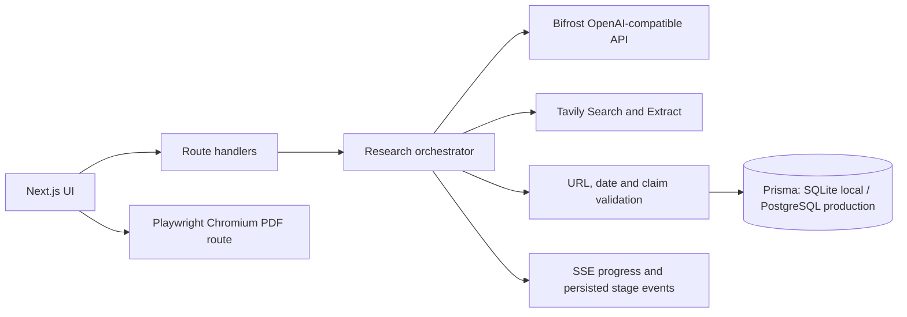

# SignalBrief architecture

SignalBrief is a server-rendered Next.js application with an observable research pipeline. The browser submits meeting details and listens to server-sent events. The server resolves the subject and prepares a research plan through Bifrost, searches and extracts public pages with Tavily, checks model claims against the returned evidence, then stores the briefing and source graph in Prisma.

## Request path

1. `POST /api/briefings` validates and stores a meeting and pending briefing.
2. The UI opens `GET /api/briefings/:id/research`. An atomic status update prevents a second run for that briefing.
3. The pipeline normalizes the subject and calculates its 30-day window. If the meeting is in the future, the window ends at the current research time.
4. Bifrost identifies the subject and returns at least four query angles in validated JSON. Ambiguity or model failure stops the run with a useful error.
5. Tavily Search runs each planned query. URL duplicates and near-identical titles are removed. Candidate sources retain the original URL, title, domain, publication date, query and scores.
6. Tavily Extract fetches selected source pages. If extraction is incomplete, the search snippet is retained and the limitation is visible in the research activity.
7. Only sources with parseable publication dates inside the research window enter claim extraction. Other results remain available as background and are not treated as recent developments.
8. Bifrost extracts claims and possible contradictions. The application maps every model-provided source URL to the exact supplied source set and rejects unmatched citations. Claims with unknown or out-of-window event dates are excluded from recent findings.
9. A second Bifrost pass composes the summary, implications, questions and watchlist from accepted claims. The application maps generated citations back to accepted claims and discards unmatched report items.
10. Prisma stores sources, claims, relations, briefing data and stage events. The UI presents status and source details. The PDF route renders the same stored briefing through Playwright.

## Observable stages

The SSE stream reports actual pipeline callbacks: normalization, entity identification, planning, web research, extraction, evidence processing, claim verification, meeting intelligence, quality check and briefing generation. Stage events are also persisted as `ResearchRun` rows and event JSON for `/api/briefings/:id/status`. A failure leaves the briefing marked failed, keeps candidate Tavily sources already collected, records a sanitized error, and supports retry.

## Trust boundaries

- Tavily and Bifrost are called only from server modules.
- Scraped page text is untrusted input and is clearly delimited in prompts.
- The model is instructed not to follow page instructions or create sources. Application-level URL mapping is the citation allowlist.
- Event dates must be explicit in the supplied evidence and pass a date-window check.
- `verified` is a system assessment based on the supplied evidence, not a guarantee of truth or independent corroboration. The report keeps confidence and uncertainty visible.
- Relevance scores use configurable weighted heuristics: entity match 30%, meeting fit 25%, recency 20%, publisher heuristic 15%, completeness 10%. They are not probability or factual-confidence scores.

## Persistence

`Meeting` owns one or more `Briefing` records. Each briefing owns its `ResearchRun`, `Source` and `Claim` records. `ClaimSource` links claims to sources. JSON text columns hold presentational arrays while claims, sources and joins remain relational for source browsing and attribution.

`prisma/schema.prisma` is the local SQLite development schema. `prisma/schema.postgresql.prisma` and `prisma/migrations/` are the production PostgreSQL schema/migration path. Prisma 7 uses the `PrismaBetterSqlite3` and `PrismaPg` driver adapters, while `prisma.config.ts` configures the PostgreSQL migration path. Docker runs `prisma migrate deploy` on startup.

## Main modules

- `src/lib/research/tavily.ts`: official Tavily HTTP calls, response validation, retries, cache and source extraction.
- `src/lib/ai/bifrost.ts`: configurable OpenAI-compatible Bifrost chat-completions client and one schema-repair attempt.
- `src/lib/pipeline/orchestrator.ts`: stages, evidence gates, meeting synthesis and persistence.
- `src/lib/research/ranking.ts`: transparent relevance heuristic.
- `src/lib/utils.ts`: date windows, URL normalization and shared helpers.
- `src/lib/security/request-guards.ts`: body/rate-limit helpers and error redaction.
- `src/lib/export/pdf.ts`: escaped HTML, HTTPS-only citations and one-page Chromium rendering.

## Runtime notes

The application is a single Next.js service and does not use an external queue. A live research request occupies the route until the stream completes. For higher concurrency, move orchestration to a durable job queue and stream status from persisted events. In-memory rate limiting and caches are process-local; use shared storage for multi-instance deployments. User login and record ownership are not yet implemented.
